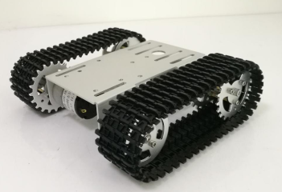
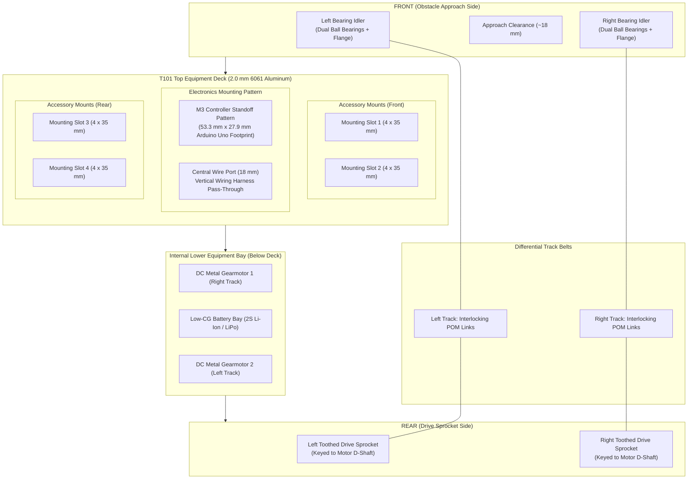
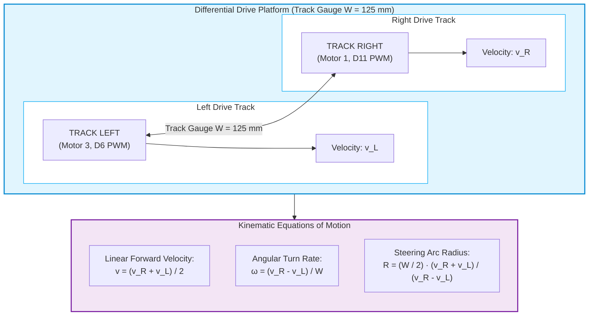

# Mechanical Chassis & Platform - tracked_bot

Mechanical system overview, physical chassis specifications, and assembly documentation for the **tracked_bot** autonomous tracked robot platform.

---

## 📋 Table of Contents

1. [Mechanical System Overview](#-mechanical-system-overview)
2. [Platform Visual Feature Breakdown](#-platform-visual-feature-breakdown)
3. [Top Deck & Chassis Geometry Diagram](#-top-deck--chassis-geometry-diagram)
4. [T101 Chassis Specifications](#-t101-chassis-specifications)
5. [Skid-Steering Kinematics](#-skid-steering-kinematics)
6. [Mechanical Documentation & Guides](#-mechanical-documentation--guides)
7. [Media & Diagrams Index](#-media--diagrams-index)

---

## 🚜 Mechanical System Overview

The mechanical locomotion platform of **tracked_bot** is built upon the **T101 Mini Tracked Tank Chassis**. Designed for structural rigidity, stability on uneven terrain, and high payload-to-weight ratio, the platform employs a high-grade anodized aluminum alloy chassis driven by two independent DC metal gearmotors coupled to modular continuous caterpillar tracks.



The platform operates via **differential skid-steering** (tank steering), enabling 360° in-place zero-radius turns by driving opposing tracks in reverse directions, as well as smooth variable-radius turning arcs.

---

## 🔍 Platform Visual Feature Breakdown

Referencing the physical platform photograph above ([images/body_platform.png](images/body_platform.png)), the mechanical architecture consists of seven primary functional sub-assemblies:

```
  (1) Front Bearing Idler Wheels (Dual Ball Bearings + 5-Screw Hub Flange)
  (2) High-Traction Modular Tracks (Engineering Plastic Links with Inner Guide Lugs)
  (3) Formed 6061 Aluminum Deck & Side Chassis Walls (2.0 mm Anodized Alloy)
  (4) Central Circular Cable Pass-Through Port (Clean Vertical Wiring Harness Route)
  (5) 4x Longitudinal Accessory Mounting Slots (Sliding Brackets & Sensor Mounts)
  (6) Standardized M3 Controller Standoff Pattern (Arduino Uno R3 / Mega Footprint)
  (7) Rear Toothed Drive Sprockets (CNC Aluminum Keyed to Motor D-Shafts)
  (8) Under-Deck 25 mm Metal DC Gearmotors & Protected Battery Bay
```

### 1. Monolithic 6061 Aluminum Chassis Body
The main chassis plate is precision-cut and CNC-bent from **2.0 mm thick 6061 sandblasted and anodized aluminum alloy**. The downward-folded structural side flanges form an inverted U-channel profile that exhibits exceptional torsional stiffness against skid-steering shear stresses while maintaining an overall chassis weight of only ~530 g.

### 2. Top Equipment Deck & Mounting Slots
As shown in [images/body_platform.png](images/body_platform.png), the upper deck incorporates:
- **Central Cable Pass-Through Hole ($\varnothing \approx 18\text{ mm}$):** Allows motor power leads, battery cables, and encoder wires to route directly up from the lower equipment bay to the controller shield without exterior hanging wires.
- **Four Longitudinal Adjustment Slots ($4 \times 35\text{ mm}$):** Permit continuous linear positioning for sensor brackets, camera pan-tilt gimbals, ultrasonic distance sensors, or battery securing straps.
- **M3 Mounting Hole Array:** Pre-tapped and clearance holes matching the standard Arduino Uno R3 / Mega 2560 standoff pitch ($53.3\text{ mm} \times 27.9\text{ mm}$), ensuring rigid mounting of the Uno+WiFi R3 and L293D motor driver stack.

### 3. Drive Sprockets vs. Idler Wheels
- **Toothed Drive Sprockets (Rear):** Machined from solid aluminum with radial weight-reduction cutouts. The outer circumference features positive-engagement gear teeth that mate precisely with the drive windows of the caterpillar track links. Each sprocket hub contains two M3 set-screws (grub screws) that lock onto the flat facet of the motor D-shaft.
- **Bearing Idler Wheels (Front):** Machined aluminum wheels featuring dual miniature deep-groove ball bearings and a 5-screw outer retaining ring. The idlers maintain track alignment, tension, and provide an elevated obstacle approach angle.

### 4. Continuous Caterpillar Tracks
The track belts consist of modular, high-durability **engineering plastic / POM (polyoxymethylene) interlocking tread links** connected with stainless steel hinge pins:
- **Outer Surface:** Aggressive chevron-patterned anti-skid ribs for high friction on carpet, concrete, tile, and packed dirt.
- **Inner Surface:** Double-ridge center guide horns that straddle the sprocket teeth and idler wheel rims, preventing track derailment during aggressive in-place skid-steering maneuvers.

### 5. Lower Equipment & Motor Bay
Located directly beneath the upper aluminum deck, the central chassis cavity encloses:
- **Dual 25 mm High-Torque DC Gearmotors:** Cylindrical metal gearmotors (visible in [images/body_platform.png](images/body_platform.png) under the deck edge) secured with four M3 machine screws into the structural side walls.
- **Low Center-of-Gravity (CG) Battery Bay:** Accommodates a 2S 18650 Li-ion cell holder or 7.4V LiPo battery. Placing the heaviest component below the wheel axle line ensures maximum incline stability and eliminates chassis roll during fast braking.

---

## 📐 Top Deck & Chassis Geometry Diagram

The following ASCII schematic illustrates the physical top-down layout and component distribution observed in [images/body_platform.png](images/body_platform.png):



---

## ⚙️ T101 Chassis Specifications

| Parameter | Specification | Engineering Details & Observations |
| :--- | :--- | :--- |
| **Model** | **T101 Mini Tracked Platform** | Standard desktop-scale autonomous robotics platform |
| **Chassis Material** | **6061 Aluminum Alloy** | 2.0 mm thickness, sandblasted, anti-oxidation anodized |
| **Track Material** | **Engineering Plastic (POM / Nylon)** | Modular links linked by stainless steel hinge pins |
| **Wheel Material** | **CNC Machined Aluminum** | Anodized finish, dual ball bearings on idlers |
| **Overall Dimensions ($L \times W \times H$)** | **~190 mm $\times$ 165 mm $\times$ 60 mm** | Compact desktop footprint |
| **Track Width** | **~40 mm** | Large contact patch distributing ground pressure |
| **Track Gauge ($W$)** | **~125 mm** | Centerline distance between left and right tracks |
| **Ground Contact Length ($L$)** | **~110 mm** | Effective track surface in ground contact |
| **Unladen Weight** | **~530 g** | Bare chassis including motors, tracks, and wheels |
| **Maximum Payload** | **~2.0 kg – 3.0 kg** | Ample margin for controller, batteries, and sensor payloads |
| **Operating Voltage** | **6.0 V – 9.0 V DC** | Nominal 7.4 V from 2S Li-ion / LiPo pack |
| **Ground Clearance** | **~18 mm** | Minimum underbody clearance over obstacles |
| **Locomotion Mode** | **Differential Skid-Steering** | Zero-radius in-place spin ($R = 0$) capability |

---

## 🔄 Skid-Steering Kinematics

Differential tracked locomotion relies on differing track velocities ($v_L$ and $v_R$) to effect steering:



- **Straight Forward/Reverse:** $v_L = v_R$ (Both tracks driven at equal PWM duty cycles).
- **Pivot Turn (One Track Locked):** $v_L = 0$ or $v_R = 0$ (Robot pivots around the stationary track; turning radius $R = W/2$).
- **Zero-Radius Spin (In-Place Turn):** $v_L = -v_R$ (Robot spins about its geometric center with zero turning radius $R = 0$).
- **Curved Arc Turn:** $v_L \ne v_R$ with both non-zero (Gradual steering arc of radius $R = \frac{W}{2} \cdot \frac{v_R + v_L}{v_R - v_L}$).

> [!NOTE]
> Because skid-steering induces lateral track scrub against the ground, the motor torque demand increases significantly during turning. Ensure the [L293D Motor Shield](../hw/motor_shield.md) is supplied from a dedicated [high-current battery rail](../hw/power_supply.md) (not USB).

---

## 📖 Mechanical Documentation & Guides

- **[assembly_guide.md](assembly_guide.md)**: Detailed step-by-step mechanical construction manual, covering frame assembly, motor faceplate mounting, sprocket set-screw alignment, track pin sizing and tensioning, and M3 standoff placement.
- **[Hardware & Electrical Architecture (../hw/)](../hw/README.md)**: Master electrical interconnect matrix, board schematics, motor shield pin mappings, and power supply design.
- **[Software Architecture (../sw/)](../sw/README.md)**: Embedded C motion control algorithms, skid-steering kinematics, slew rate acceleration limiters, and hardware drivers.

---

## 🖼️ Media & Diagrams Index

- **Platform Assembly Reference Photo:** [images/body_platform.png](images/body_platform.png)
  
