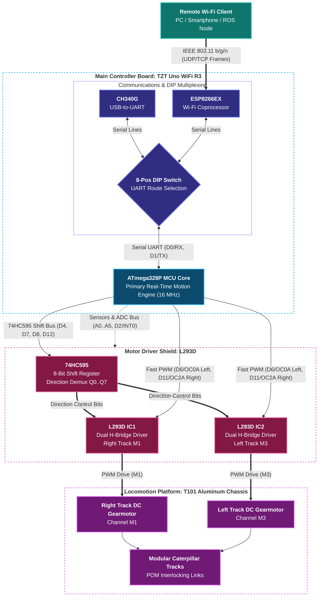
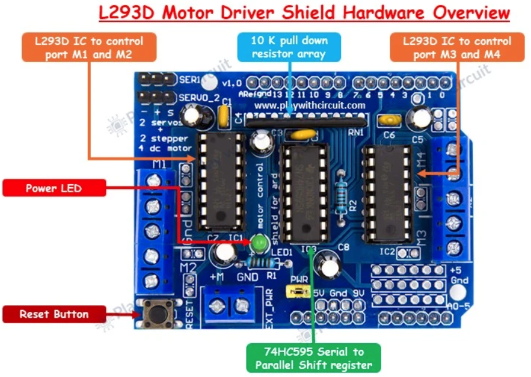
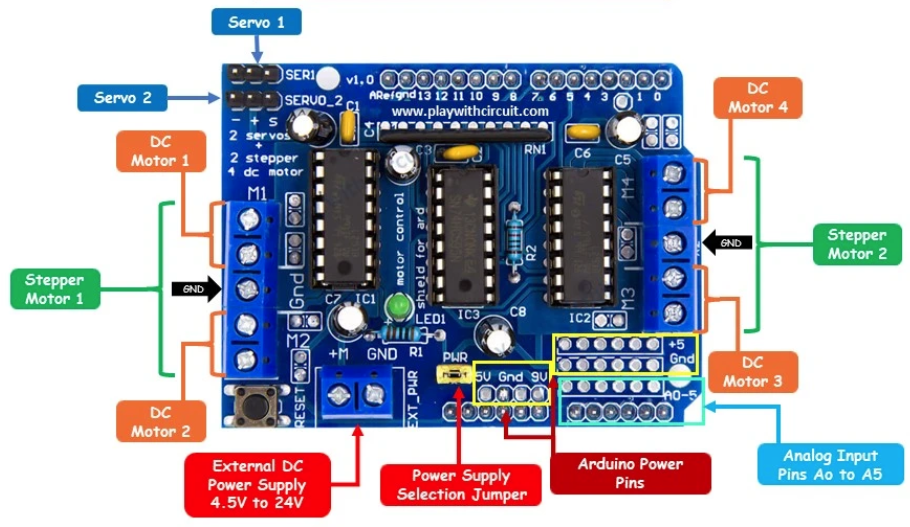

# Hardware Architecture - tracked_bot

Comprehensive engineering documentation for the electrical hardware, controller boards, power distribution, and signal routing of the **tracked_bot** autonomous tracked robot platform.

---

## 📋 Table of Contents

1. [System Architecture Overview](#-system-architecture-overview)
2. [Hardware Stack & Core Boards](#-hardware-stack--core-boards)
3. [Master Unified Pinout & Interconnect Matrix](#-master-unified-pinout--interconnect-matrix)
4. [Hardware Documentation Sitemap](#-hardware-documentation-sitemap)
5. [Component Datasheets Directory](#-component-datasheets-directory)
6. [Hardware Media & Images](#-hardware-media--images)

---

## 🚀 System Architecture Overview

The **tracked_bot** platform implements a modular dual-processor computing architecture using the standard Arduino Uno R3 mechanical and electrical footprint:

---

## 🧩 Hardware Stack & Core Boards

| Layer | Component | Hardware Model | Function & Role | Detailed Guide |
| :--- | :--- | :--- | :--- | :--- |
| **Main Board** | Hybrid Dual-SoC Controller | **Uno+WiFi R3 (ATmega328P + ESP8266)** | Dual-processor board (marketed as TZT, RobotDyn, or WeMos Uno WiFi) with ATmega328P (16 MHz) for real-time motion and ESP8266 (80 MHz) for Wi-Fi. | [main_board.md](main_board.md) |
| **Motor Driver** | Dual Quadruple Half-H Shield | **L293D Motor Shield** | 2x L293D H-bridges (up to 4 DC motors / 2 steppers) + 74HC595 shift register direction multiplexer. | [motor_shield.md](motor_shield.md) |
| **Power Distribution** | Dual-Supply Rail Architecture | **`EXT_PWR` & USB Rail** | Isolated motor power rail (2S Li-Ion 7.4V–8.4V) and clean MCU logic power (5V USB/power bank). | [power_supply.md](power_supply.md) |
| **Locomotion** | Tracked Robot Chassis | **T101 Platform** | Aluminum alloy chassis with suspension wheels, rubber tracks, and dual high-torque DC gearmotors. | [body/README.md](../body/README.md) & [body_platform.png](../body/images/body_platform.png) |
| **Peripherals** | Sensors & Telemetry | HC-SR04, MPU-6050, ADC | Ultrasonic obstacle detection, 6-axis IMU gyro/accelerometer on I2C, and battery voltage divider on A0. | [main_board.md](main_board.md) |

---

## 📌 Master Unified Pinout & Interconnect Matrix

This master matrix consolidates all physical signal mappings between the **ATmega328P microcontroller**, the **ESP8266 Wi-Fi coprocessor**, and the **L293D Motor Driver Shield**:

### 1. Digital I/O Pins (D0 - D13)

| Arduino Pin | AVR Port | AVR Hardware Function | L293D Shield Interconnect | ESP8266 Interconnect | `tracked_bot` Dedicated Purpose |
| :---: | :---: | :--- | :--- | :--- | :--- |
| **D0** | `PD0` | `RXD` (USART0 Receiver) | *Not connected* | Connected via DIP **SW1** | **Serial In:** Receives motion commands from ESP8266 Wi-Fi |
| **D1** | `PD1` | `TXD` (USART0 Transmitter) | *Not connected* | Connected via DIP **SW2** | **Serial Out:** Transmits telemetry packets to ESP8266 Wi-Fi |
| **D2** | `PD2` | `INT0` (External Interrupt 0) | *Not connected* | *Not connected* | **FREE GPIO:** Low-latency sensor interrupt or wheel encoder |
| **D3** | `PD3` | `OC2B` (Timer2 Output Compare B) | Motor 2 Speed PWM (`PWM2B`) | *Not connected* | Reserved for Auxiliary Motor 2 |
| **D4** | `PD4` | `XCK` / `T0` (General I/O) | 74HC595 Shift Clock (`DIR_CLK`)| *Not connected* | **Shift Register Clock:** Clocks direction bits into 74HC595 |
| **D5** | `PD5` | `OC0B` (Timer0 Output Compare B) | Motor 4 Speed PWM (`PWM0B`) | *Not connected* | Reserved for Auxiliary Motor 4 |
| **D6** | `PD6` | `OC0A` (Timer0 Output Compare A) | Motor 3 Speed PWM (`PWM0A`) | *Not connected* | **Left Track Speed PWM:** Timer0 Fast PWM (0–255) |
| **D7** | `PD7` | `AIN1` (General I/O) | 74HC595 Output Enable (`DIR_EN`) | *Not connected* | **Shift Register Output Enable:** Active-low output driver |
| **D8** | `PB0` | `ICP1` / `CLKO` (General I/O) | 74HC595 Serial Data (`DIR_SER`) | *Not connected* | **Shift Register Serial Data:** Serial bit-stream input |
| **D9** | `PB1` | `OC1A` (Timer1 Output Compare A) | Servo 2 PWM (`PWM1A`) | *Not connected* | Reserved for Pan-Tilt Servo 2 |
| **D10** | `PB2` | `OC1B` (Timer1 Output Compare B) | Servo 1 PWM (`PWM1B`) | *Not connected* | Reserved for Pan-Tilt Servo 1 |
| **D11** | `PB3` | `OC2A` / `MOSI` | Motor 1 Speed PWM (`PWM2A`) | *Not connected* | **Right Track Speed PWM:** Timer2 Fast PWM (0–255) |
| **D12** | `PB4` | `MISO` (General I/O) | 74HC595 Latch Clock (`DIR_LATCH`)| *Not connected* | **Shift Register Latch:** Latches internal buffer to outputs |
| **D13** | `PB5` | `SCK` (Onboard LED) | *Not connected* (Arduino LED) | *Not connected* | **FREE GPIO:** Built-in LED / SPI SCK clock |

### 2. Analog Input & I2C Pins (A0 - A5 / D14 - D19)

All analog pins pass directly through the L293D shield to the top breakout pads without electrical interference:

| Arduino Pin | AVR Port | Secondary Hardware Function | System Role in `tracked_bot` |
| :---: | :---: | :--- | :--- |
| **A0** | `PC0` | `ADC0` / `PCINT8` | **Battery Voltage Sense:** 4:1 resistor voltage divider to monitor 2S battery pack |
| **A1** | `PC1` | `ADC1` / `PCINT9` | **Ultrasonic Sensor (HC-SR04):** Trigger output pulse pin |
| **A2** | `PC2` | `ADC2` / `PCINT10` | **Ultrasonic Sensor (HC-SR04):** Echo input pulse measurement pin |
| **A3** | `PC3` | `ADC3` / `PCINT11` | **Auxiliary GPIO / Analog Input** (free for infrared or bumper switches) |
| **A4** | `PC4` | `ADC4` / `SDA` (I2C Data) | **I2C Bus SDA:** Connected to MPU-6050 6-DOF IMU gyroscope/accelerometer |
| **A5** | `PC5` | `ADC5` / `SCL` (I2C Clock) | **I2C Bus SCL:** Connected to MPU-6050 6-DOF IMU gyroscope/accelerometer |

### 3. Power Supply and Ground Terminals

| Terminal / Pin | Rail Voltage | Source / Destination | Functional Role |
| :--- | :---: | :--- | :--- |
| **`EXT_PWR (+)`** | **4.5 V – 24 V DC** | External Motor Battery (2S Li-Ion / 7.4V) | Powers L293D IC1 & IC2 H-bridge motor drive stages |
| **`EXT_PWR (GND)`**| **0 V (GND)** | Battery Negative Lead | Common ground return for motor current loop |
| **`5V` (Header)** | **5.0 V DC** | Arduino 5V Regulator / USB bus | Powers ATmega328P logic, 74HC595, and servo headers |
| **`3V3` (Header)**| **3.3 V DC** | Onboard 3.3V LDO Regulator | Dedicated logic supply for ESP8266 Wi-Fi SoC |
| **`GND` (Headers)**| **0 V (GND)** | Shared System Ground Plane | Common reference for all logic, sensors, and peripherals |
| **`VIN` (Header)** | **7.0 V – 12 V DC**| Connected to DC Barrel Jack / `EXT_PWR` | Sourced via DC jack; connected to motor rail when `PWR` jumper is ON |

---

## 📖 Hardware Documentation Sitemap

- [main_board.md](main_board.md): Complete specifications for the TZT Uno WiFi R3, 8-position DIP switch mode table, serial multiplexing, and firmware flashing workflows.
- [motor_shield.md](motor_shield.md): L293D driver architecture, 74HC595 shift register bit definitions, Timer0 Fast PWM speed control, and DC/stepper/servo connection guides.
- [power_supply.md](power_supply.md): Power distribution topology, battery chemistry selection, current budgets, inrush spike management, decoupling, and brownout protection.

---

## 📂 Component Datasheets Directory

The [`datasheets/`](datasheets/) directory contains original manufacturer engineering documentation:

| Integrated Circuit | Datasheet Link | Key Features & Focus |
| :--- | :--- | :--- |
| **Microchip ATmega328P** | [atmega328p.pdf](datasheets/atmega328p.pdf) | 8-bit AVR RISC microcontroller, Timer0/Timer1/Timer2 registers, USART0 hardware. |
| **Espressif ESP8266EX** | [esp8266ex.pdf](datasheets/esp8266ex.pdf) | 2.4 GHz Wi-Fi SoC, Tensilica L106 32-bit core, UART interface, power management. |
| **WCH CH340G** | [ch340.pdf](datasheets/ch340.pdf) | USB to Serial UART bridge controller and driver specifications. |
| **TI / ST L293 / L293D** | [l293.pdf](datasheets/l293.pdf) | Quadruple high-current half-H drivers, internal flyback clamping diodes, thermal limits. |
| **TI SN74HCS595-Q1** | [sn74hcs595-q1.pdf](datasheets/sn74hcs595-q1.pdf) | 8-bit serial-in parallel-out shift register with output latches and Schmitt-trigger inputs. |

---

## 🖼️ Hardware Media & Images

The [`images/`](images/) directory contains board layout and pinout diagrams:

- **Motor Driver Shield Assembly:** [images/motor_driver_shield.png](images/motor_driver_shield.png)
  

- **Motor Driver Shield Pinout Diagram:** [images/motor_driver_shield_pinout.png](images/motor_driver_shield_pinout.png)
  

- **Mechanical Chassis & Track Assembly:** [body_platform.png](../body/images/body_platform.png)
  
