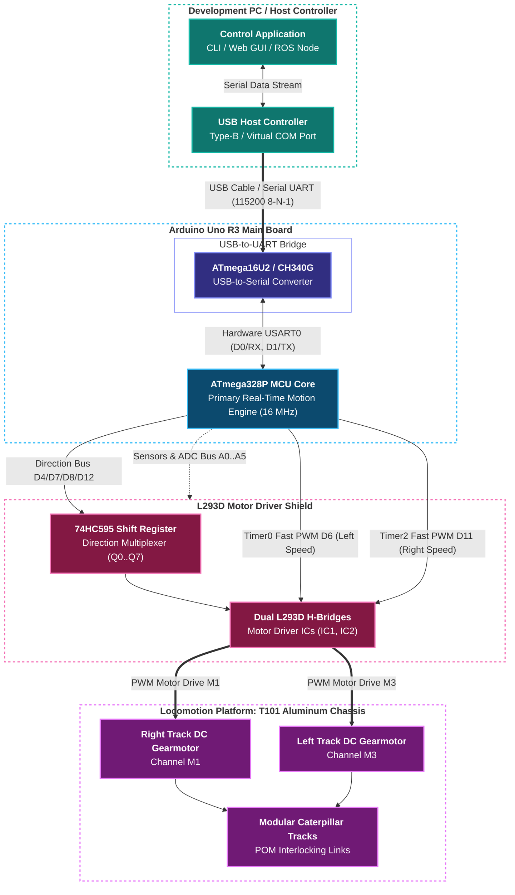

# Main Controller Board - Arduino Uno R3 (ATmega328P)

Hardware reference, component architecture, pinout, and configuration guide for the **Arduino Uno R3** microcontroller development board used as the main controller in the **tracked_bot** platform.

This board features a **Microchip ATmega328P** primary motion microcontroller clocked at 16 MHz alongside an onboard **USB-to-UART serial interface** (ATmega16U2 or CH340G) providing deterministic serial communication to host controllers at 115200 baud.

---

## 📋 Table of Contents

1. [Hardware Overview & Key Components](#-hardware-overview--key-components)
2. [Datasheet References](#-datasheet-references)
3. [Component Specifications](#-component-specifications)
4. [Serial UART Communication Architecture](#-serial-uart-communication-architecture)
5. [Complete Pinout and Signal Routing](#-complete-pinout-and-signal-routing)
6. [Operational Workflows (Programming & Running)](#-operational-workflows-programming--running)
7. [Hardware Interconnection Architecture](#-hardware-interconnection-architecture)
8. [Board Variants & Hardware Compatibility](#-board-variants--hardware-compatibility)

---

## 🔧 Hardware Overview & Key Components

The Arduino Uno R3 provides a robust, single-microcontroller embedded control platform:

1. **Primary Motion Controller (ATmega328P):**
   - 8-bit AVR RISC microcontroller clocked at 16 MHz via external crystal resonator.
   - Handles real-time motor control (Timer0 and Timer2 Fast PWM), 74HC595 shift register direction timing, periodic telemetry reporting, and differential skid-steering kinematics.
   - Runs deterministic, bare-metal C firmware without RTOS overhead.

2. **USB-to-UART Interface (ATmega16U2 / CH340G):**
   - Provides USB connectivity to a host development PC, single-board computer (e.g. Raspberry Pi), or ROS navigation node.
   - Bridges host serial commands directly to the ATmega328P hardware USART0 (`PD0/RX`, `PD1/TX`) at 115200 baud (8-N-1).
   - Handles automatic DTR reset for bootloader synchronization during firmware flashing.

3. **Power Regulation & Distribution:**
   - 5.0 V on-board linear regulator (powered via USB 5V or external `VIN` 7–12V rail).
   - Onboard 3.3 V low-dropout (LDO) regulator providing auxiliary current for low-voltage sensors.

---

## 📚 Datasheet References

Original manufacturer datasheets for the core integrated circuits on this board are preserved in the repository:

- [ATmega328P Datasheet (Microchip 8-bit AVR Microcontroller)](datasheets/atmega328p.pdf)
- [CH340 USB to Serial UART Bridge Datasheet](datasheets/ch340.pdf)

---

## ⚡ Component Specifications

| Feature | Primary Controller (ATmega328P) |
| :--- | :--- |
| **Architecture** | 8-bit AVR RISC |
| **Clock Frequency** | 16 MHz (external crystal) |
| **Operating Voltage** | 5.0 V DC |
| **Flash Memory** | 32 KB (0.5 KB used by Optiboot bootloader) |
| **SRAM** | 2 KB internal SRAM |
| **EEPROM** | 1 KB internal EEPROM |
| **Timers** | 2x 8-bit (Timer0, Timer2), 1x 16-bit (Timer1) |
| **Hardware Serial (UART)** | 1x USART (`PD0/RXD`, `PD1/TXD`) |
| **I/O Logic Levels** | 5 V TTL/CMOS |
| **Analog Inputs** | 6 channels (10-bit ADC, A0–A5) |
| **Interrupts** | External (`INT0` on D2, `INT1` on D3), Pin Change (`PCINT0..PCINT23`) |

---

## 🔌 Serial UART Communication Architecture

All communication between the robot firmware and the host controller is conducted strictly over the **hardware USART0 interface**:

* **Baud Rate:** 115200 baud
* **Data Bits:** 8
* **Parity:** None
* **Stop Bits:** 1
* **Flow Control:** None (handled via CRC-8 validation and software ACK/NACK responses)

Incoming serial frames are ingested via the `USART_RX_vect` interrupt into a lock-free Single-Producer Single-Consumer (SPSC) ring buffer, decoded by a 5-state finite state machine (FSM), and dispatched deterministically in the main loop.

---

## 📌 Complete Pinout and Signal Routing

The headers on the Arduino Uno R3 provide standard female sockets that mate directly with the [L293D Motor Shield](motor_shield.md). The table below details signal routing and dedicated functions within `tracked_bot`:

### Digital Pins (D0 - D13)

| Pin | AVR Port | Onboard Connection | Role in `tracked_bot` |
| :--- | :--- | :--- | :--- |
| **D0 (RX)** | `PD0` | ATmega328P USART RX | **USART0 RX:** Serial binary command reception from Host |
| **D1 (TX)** | `PD1` | ATmega328P USART TX | **USART0 TX:** Serial binary telemetry transmission to Host |
| **D2** | `PD2` | Header pin | **FREE GPIO:** External Interrupt 0 (`INT0`), sensors, encoders |
| **D3** | `PD3` | Header pin / L293D `PWM2B` | Reserved (Timer2 `OC2B` for Motor 2 PWM on shield) |
| **D4** | `PD4` | Header pin / L293D `DIR_CLK` | **74HC595 Shift Clock:** Clock line for direction register |
| **D5** | `PD5` | Header pin / L293D `PWM0B` | Reserved (Timer0 `OC0B` for Motor 4 PWM on shield) |
| **D6** | `PD6` | Header pin / L293D `PWM0A` | **Left Track PWM Speed:** Timer0 `OC0A` Fast PWM |
| **D7** | `PD7` | Header pin / L293D `DIR_EN` | **74HC595 Output Enable:** Active-low output buffer enable (`~OE`) |
| **D8** | `PB0` | Header pin / L293D `DIR_SER` | **74HC595 Serial Data:** Direction bit data line (`SER`) |
| **D9** | `PB1` | Header pin / L293D `PWM1A` | Reserved for Pan-Tilt Servo 2 (Timer1 `OC1A`) |
| **D10** | `PB2` | Header pin / L293D `PWM1B` | Reserved for Pan-Tilt Servo 1 (Timer1 `OC1B`) |
| **D11** | `PB3` | Header pin / L293D `PWM2A` | **Right Track PWM Speed:** Timer2 `OC2A` Fast PWM |
| **D12** | `PB4` | Header pin / L293D `DIR_LATCH` | **74HC595 Storage Latch:** Latches direction bits to outputs (`RCLK`) |
| **D13** | `PB5` | Header pin / Onboard SCK LED | **Status Heartbeat LED:** Built-in diagnostic LED toggle |

### Analog Pins (A0 - A5 / D14 - D19)

All analog pins pass directly through the L293D motor shield to top breakout pads:

| Pin | AVR Port | Alternative Functions | Dedicated Purpose in `tracked_bot` |
| :--- | :--- | :--- | :--- |
| **A0** | `PC0` | ADC0 / PCINT8 | **Battery Voltage Sense:** 4:1 resistive divider monitoring 2S battery pack |
| **A1** | `PC1` | ADC1 / PCINT9 | **HC-SR04 Ultrasonic Trigger:** Pulse generator |
| **A2** | `PC2` | ADC2 / PCINT10 | **HC-SR04 Ultrasonic Echo:** Pulse duration measurement |
| **A3** | `PC3` | ADC3 / PCINT11 | **Auxiliary GPIO / Analog Input** |
| **A4** | `PC4` | ADC4 / I2C SDA | **I2C Bus SDA:** IMU gyroscope/accelerometer (MPU-6050) / OLED display |
| **A5** | `PC5` | ADC5 / I2C SCL | **I2C Bus SCL:** IMU gyroscope/accelerometer (MPU-6050) / OLED display |

---

## 🚀 Operational Workflows (Programming & Running)

### Workflow 1: Flashing ATmega328P Firmware (`tracked_bot`)

To compile and flash the bare-metal AVR C firmware onto the ATmega328P:

1. Disconnect or turn off the robot's external motor battery power.
2. Connect the Arduino Uno R3 to your host computer via a standard USB Type-B cable.
3. Verify the serial port device node (e.g. `/dev/ttyUSB0` or `/dev/ttyACM0` on Linux):
   ```bash
   ls -l /dev/ttyUSB* /dev/ttyACM*
   ```
4. Build and flash the firmware image using `make`:
   ```bash
   make -C sw/trackedbot/build flash PORT=/dev/ttyUSB0
   ```
5. `avrdude` will synchronize with the Optiboot / STK500v1 bootloader at 115200 baud and program the Flash memory.

---

### Workflow 2: Normal Robot Operation (UART Control)

After flashing the firmware:

1. Mount the [L293D Motor Shield](motor_shield.md) firmly onto the Arduino Uno R3 headers.
2. Connect external 2S Li-Ion / LiPo battery power according to the [power_supply.md](power_supply.md) guide.
3. Connect the host controller (PC, Raspberry Pi, or embedded SBC) to the Arduino Uno R3 via:
   - **USB Cable:** Direct connection to the Arduino USB port (creating a virtual COM / tty port on the host).
   - **Direct TTL Serial:** Connect host TX to `D0 (RX)` and host RX to `D1 (TX)` with a common ground (5V level tolerant).
4. Open the serial port at **115200 baud (8-N-1)** and begin transmitting binary protocol frames as specified in [sw/protocol.md](../sw/protocol.md).

---

## ⚡ Hardware Interconnection Architecture



For motor shield driver circuits and register assignments, refer to [motor_shield.md](motor_shield.md). For power rail wiring and battery safety, refer to [power_supply.md](power_supply.md).

---

## 🏷️ Board Variants & Hardware Compatibility

The **tracked_bot** firmware is compatible with standard Arduino Uno R3 boards and equivalent open-source hardware designs:

1. **Official Arduino Uno R3:** Uses the ATmega16U2 USB interface chip (enumerates as `/dev/ttyACM*` on Linux).
2. **Uno R3 Compatible / Clones:** Typically use the WCH CH340G USB interface chip (enumerates as `/dev/ttyUSB*` on Linux). Both versions provide identical 5V TTL serial connections to the ATmega328P USART0 core.
3. **100% Shield Compatibility:** The physical header footprint, pin spacing, and 5V logic signaling are identical across all Uno R3 variants, ensuring seamless stacking with the [L293D Motor Shield](motor_shield.md).
