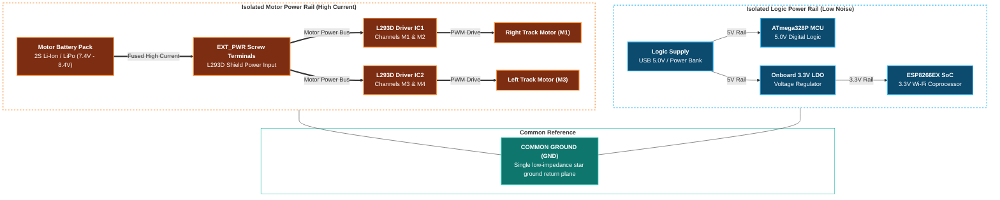
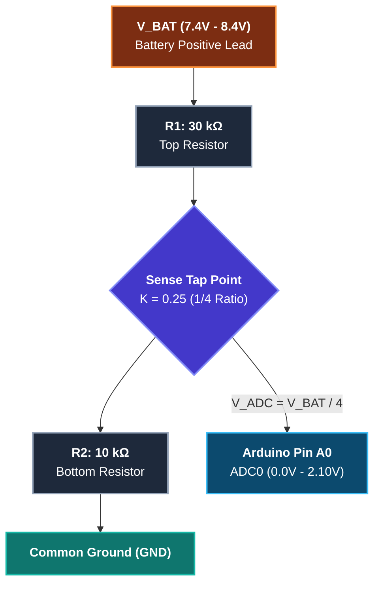

# Power Supply & Electrical Protection Architecture

Hardware power engineering guide, power distribution topology, battery sizing, and electrical noise protection for the **tracked_bot** autonomous robotics platform.

Reference Documentation & Datasheets:
- Main Controller: [main_board.md](main_board.md) | [datasheets/atmega328p.pdf](datasheets/atmega328p.pdf) | [datasheets/esp8266ex.pdf](datasheets/esp8266ex.pdf)
- Motor Driver: [motor_shield.md](motor_shield.md) | [datasheets/l293.pdf](datasheets/l293.pdf)
- Board Images: [images/motor_driver_shield.png](images/motor_driver_shield.png) | [images/motor_driver_shield_pinout.png](images/motor_driver_shield_pinout.png)

---

## 📋 Table of Contents

1. [Power Distribution Architecture](#-power-distribution-architecture)
2. [Power Supply Topologies & PWR Jumper](#-power-supply-topologies--pwr-jumper)
3. [Battery Chemistry & Sizing Options](#-battery-chemistry--sizing-options)
4. [Current Budget & Dynamic Load Analysis](#-current-budget--dynamic-load-analysis)
5. [Noise Suppression, Decoupling & Brownout Prevention](#-noise-suppression-decoupling--brownout-prevention)
6. [Battery Voltage Monitoring (ADC on A0)](#-battery-voltage-monitoring-adc-on-a0)
7. [Electrical Safety & Protection Best Practices](#-electrical-safety--protection-best-practices)

---

## ⚡ Power Distribution Architecture

The `tracked_bot` system separates sensitive digital processing logic from inductive, high-current motor drive loads:

---

## ⚠️ Power Supply Topologies & PWR Jumper

The L293D shield provides a 2-pin jumper header labeled **`PWR`** (or `PWR_JMP`) positioned immediately beside the blue **`EXT_PWR`** screw terminal block.

> [!WARNING]
> **CRITICAL SHORT-CIRCUIT HAZARD:**
> If you connect an external battery or DC power supply to the `EXT_PWR` terminal while the `PWR` jumper is in place, and simultaneously connect the Arduino to a computer via USB or DC barrel jack, the two power supplies are placed directly in parallel. This can destroy the Arduino board, overheat the onboard regulators, and burn out the USB port of your development computer.

### Configuration Matrix:

| Mode | `PWR` Jumper State | Motor Rail Source (`EXT_PWR`) | Logic Rail Source (MCU) | Advantages / Drawbacks |
| :--- | :---: | :--- | :--- | :--- |
| **Topology A: Dual Isolated Supplies** *(Recommended)* | **REMOVED (Open)** | 2S Li-Ion / LiPo (7.4 V – 8.4 V) on `EXT_PWR` | 5 V USB Power Bank or separate 5 V buck regulator | **Optimal:** Complete electrical isolation prevents motor-induced voltage sags from causing MCU brownout resets. |
| **Topology B: Shared Single Supply** | **INSTALLED (Closed)** | 7.4 V – 9.0 V Battery connected to `EXT_PWR` or DC Jack | Sourced through Arduino onboard LDO from `VIN` | **Compact:** Single battery pack powers everything. Higher risk of brownouts during high-torque skid turns. |

---

## 🔋 Battery Chemistry & Sizing Options

Differential skid-steering tracked vehicles demand sustained current when overcoming mechanical friction during turns. Recommended battery configurations:

| Chemistry | Configuration | Nominal Voltage | Full Charge | Usable Capacity | Recommendation for tracked_bot |
| :--- | :---: | :---: | :---: | :---: | :--- |
| **Li-Ion (18650)** | 2S1P | 7.4 V | 8.4 V | 2200 – 3000 mAh | **Highly Recommended:** Excellent energy density, low internal resistance, low sag under load. |
| **Li-Po Pack** | 2S (7.4V) | 7.4 V | 8.4 V | 1000 – 2200 mAh | **Highly Recommended:** High continuous discharge rating (20C–30C), compact form factor. |
| **NiMH Pack** | 6x AA Cells | 7.2 V | 8.4 V | 1800 – 2500 mAh | **Good Alternative:** Readily available, robust, safe charging characteristics. |
| **Alkaline** | 6x AA Cells | 9.0 V | 9.6 V | 1500 mAh | **Temporary / Testing Only:** High internal resistance causes rapid voltage drop under motor load. |
| **9V PP3 Block** | 1x 6F22 | 9.0 V | 9.6 V | ~400 mAh | **DO NOT USE:** Cannot provide motor stall current; collapses within seconds. |

---

## 📊 Current Budget & Dynamic Load Analysis

| Subsystem | Component | Typical Idle Current | Active / Operating Current | Peak / Stall Current |
| :--- | :--- | :---: | :---: | :---: |
| **Controller** | ATmega328P (16 MHz, 5V) | 12 mA | 18 mA | 20 mA |
| **Wi-Fi Module** | ESP8266EX (80 MHz, TX mode) | 35 mA | 80 mA | 170 mA (RF bursts) |
| **USB Interface** | CH340G Bridge | 10 mA | 12 mA | 15 mA |
| **Shift Register** | SN74HC595N Logic | < 1 mA | 5 mA | 10 mA |
| **Left Motor (M3)** | DC Gearmotor (3–6V / 7.4V) | 0 mA | 180 – 350 mA (cruising) | 800 mA – 1.2 A (stall) |
| **Right Motor (M4)** | DC Gearmotor (3–6V / 7.4V) | 0 mA | 180 – 350 mA (cruising) | 800 mA – 1.2 A (stall) |
| **Total System** | | **~60 mA** | **~450 – 800 mA** | **~1.8 A – 2.5 A** |

> [!NOTE]
> During in-place pivot turns (`MOTION_SPIN_LEFT` / `MOTION_SPIN_RIGHT`), both motors draw maximum torque against the ground resistance. The power supply must be capable of delivering at least **2.0 A peak** without dropping below 6.5 V on the `EXT_PWR` rail.

---

## 🛡️ Noise Suppression, Decoupling & Brownout Prevention

Brush-type DC motors generate broad-spectrum electromagnetic interference (EMI) and high-voltage back-EMF inductive spikes that can corrupt digital communication or trigger MCU resets.

### 1. Motor Terminal Capacitive Filtering:
To quench brush arcing and suppress RF noise:
- Solder a **100 nF (0.1 µF, code 104) ceramic capacitor** directly across the two motor terminals.
- For optimal industrial suppression, solder two additional 100 nF ceramic capacitors: one from positive terminal to motor metal can, and one from negative terminal to motor metal can.

### 2. Bulk Capacitive Reservoir on `EXT_PWR`:
- Solder or clamp an **electrolytic capacitor (470 µF to 1000 µF, 25 V rating)** directly across the `EXT_PWR` screw terminals (`+` and `GND`).
- This reservoir buffers current during sudden motor acceleration transitions, absorbing inrush spikes before they collapse the supply rail.

### 3. Common Ground Reference:
- When using dual power supplies (Mode A), verify that the battery GND and Arduino GND are tied together. On the L293D shield, the GND plane is shared across both terminal blocks and header pins.

---

## 📈 Battery Voltage Monitoring (ADC on A0)

To prevent deep discharging of Li-Ion/Li-Po batteries (which must never drop below 3.0 V per cell / 6.0 V total for a 2S pack), an analog voltage sensing circuit is connected to analog input **`A0`** (`PC0`):

### Voltage Divider Calculation:
$$\text{Division Ratio } K = \frac{R_2}{R_1 + R_2} = \frac{10\,\text{k}\Omega}{30\,\text{k}\Omega + 10\,\text{k}\Omega} = 0.25$$

At full charge ($V_{BAT} = 8.4\,\text{V}$):
$$V_{ADC} = 8.4\,\text{V} \times 0.25 = 2.10\,\text{V} \quad (\text{well within the 5.0V ADC reference range})$$

### Conversion Formula:
$$V_{BAT} = \frac{\text{ADC\_Value} \times V_{REF}}{1024} \times \frac{R_1 + R_2}{R_2} = \frac{\text{ADC\_Value} \times 5.0\,\text{V}}{1024} \times 4.0$$

A software threshold in the firmware triggers low-battery warnings at $V_{BAT} \le 6.8\,\text{V}$ and emergency motor shutdown at $V_{BAT} \le 6.4\,\text{V}$.

---

## 🔒 Electrical Safety & Protection Best Practices

1. **Inline Fuse:** Place a **2.5 A fast-acting or PPTC resettable fuse** in series with the battery positive terminal lead to protect wiring against dead shorts.
2. **Polarity Verification:** Double-check terminal polarity before tightening `EXT_PWR` screw terminals (`+` on the left, `GND` on the right as labeled on the PCB).
3. **Power Switch:** Install a sturdy single-pole double-throw (SPDT) switch rated for at least 3 A DC in series with the battery positive line.
4. **Thermal Monitoring:** Periodically check the temperatures of IC1, IC2, and the onboard 5 V regulator after intense operation. If the L293D ICs become too hot to touch (>70 °C), reduce continuous duty cycle or install miniature passive heat sinks.
