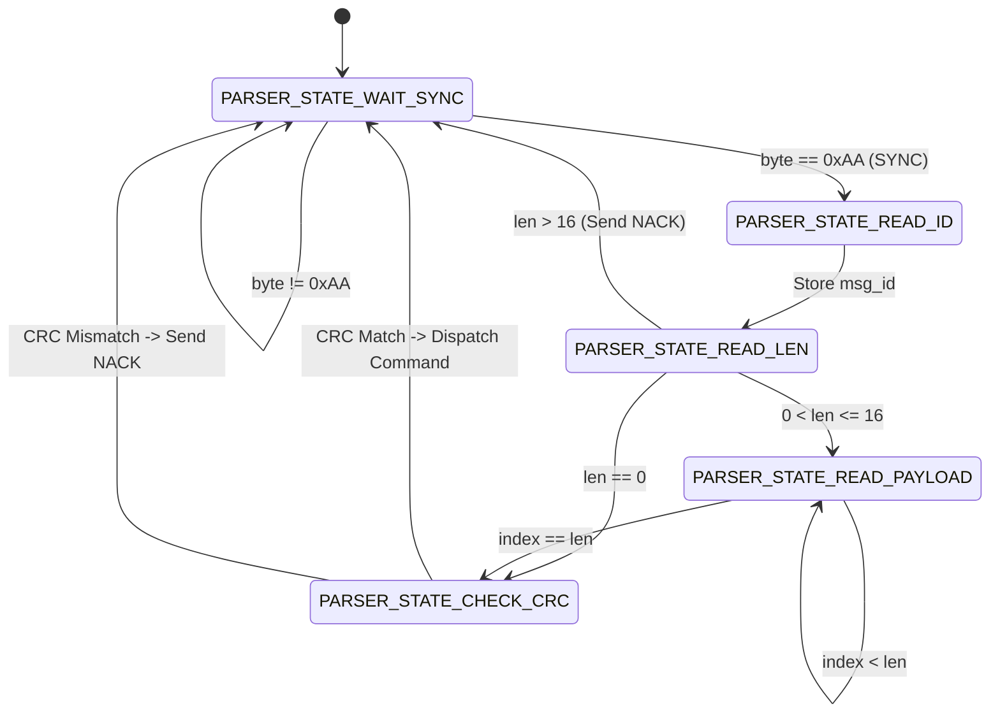
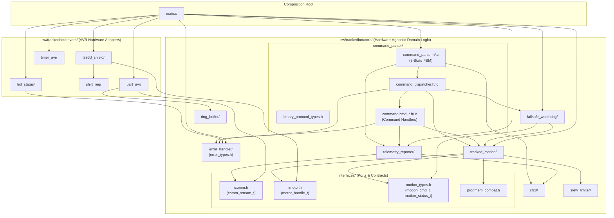
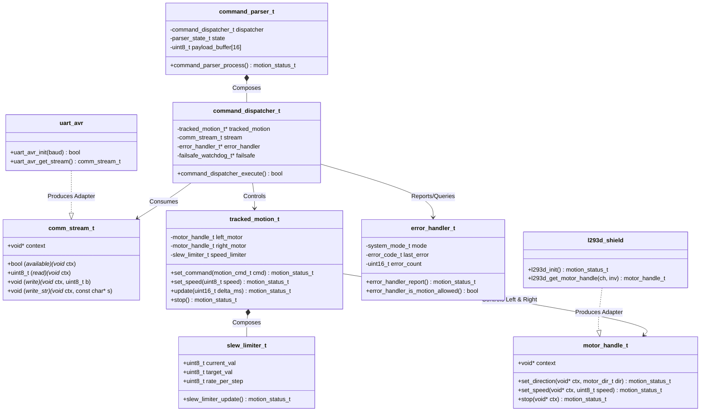
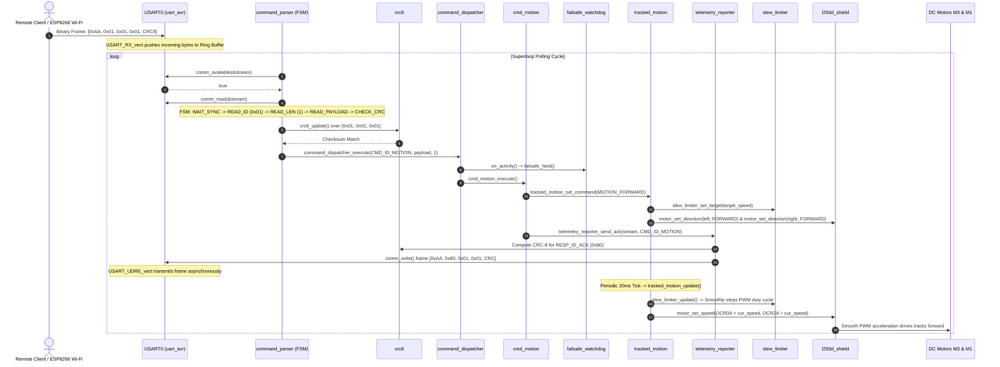

# Software Architecture & SOLID Design - tracked_bot

This document specifies the **Hexagonal Software Architecture (Ports & Adapters)** of the **tracked_bot** firmware for the **ATmega328P** microcontroller (16 MHz), the directory layout, the contract header specifications (`core/interfaces/`), and the implementation of **SOLID** design principles, Command Pattern dispatching, and safety interlocks in Embedded C.

---

## 📋 Table of Contents

1. [Architectural Principles (SOLID, Hexagonal & Fault Containment)](#-architectural-principles-solid-hexagonal--fault-containment)
2. [Software Directory Structure](#-software-directory-structure)
3. [Contracts, Ports & Domain Types (`core/interfaces/` & `core/error_handler/`)](#-contracts-ports--domain-types-coreinterfaces--coreerror_handler)
4. [Encapsulation & Localization of Hardware Constants](#-encapsulation--localization-of-hardware-constants)
5. [Tracked Locomotion Kinematics (`tracked_motion`) & Soft-Start Slew Limiting](#-tracked-locomotion-kinematics-tracked_motion--soft-start-slew-limiting)
6. [Binary Communication Protocol & Dispatch Architecture](#-binary-communication-protocol--dispatch-architecture)
7. [Centralized Error Handling, Safety Modes & Telemetry](#-centralized-error-handling-safety-modes--telemetry)
8. [Status LED Driver & Optical Cadences (`led_status`)](#-status-led-driver--optical-cadences-led_status)
9. [Build System, Device Permissions & Flashing](#-build-system-device-permissions--flashing)
10. [Dependency & Architecture Graphs](#-dependency--architecture-graphs)
    - [Static Module Dependency Graph](#static-module-dependency-graph)
    - [Contracts & Dependency Injection Class Diagram](#contracts--dependency-injection-class-diagram)
    - [Binary Command Processing & Telemetry Sequence Diagram](#binary-command-processing--telemetry-sequence-diagram)
11. [Cross-Reference & Related Documentation](#-cross-reference--related-documentation)

---

## 🏛️ Architectural Principles (SOLID, Hexagonal & Fault Containment)

The firmware is structured according to **Ports & Adapters (Hexagonal Architecture)** and **SOLID** principles tailored for resource-constrained 8-bit AVR microcontrollers:

1. **Interface Ownership & Inversion of Control (DIP - Dependency Inversion Principle):**
   - Following the architectural rule *"Clients own the interfaces"*, all contract definitions reside in **`core/interfaces/`**.
   - Core domain logic in `core/` defines what it requires to operate (`imotor.h` for motor actuator control, `icomm.h` for byte-stream communication, `motion_types.h` for kinematic states and status codes).
   - Higher-level domain modules never depend on low-level peripheral drivers; both depend on abstract interface contracts.

2. **Hardware-Agnostic Core Domain (SRP - Single Responsibility Principle):**
   - Files within `core/` have **zero dependencies** on AVR-specific hardware headers (`<avr/io.h>`, `<avr/interrupt.h>`) or MCU peripheral registers.
   - Cross-platform Flash storage macros (`PROGMEM`, `pgm_read_byte`) are abstracted in `progmem_compat.h` with native x86/ARM fallbacks, allowing core algorithms (kinematics, slew limiter, CRC-8, binary packet FSM, ring buffer) to compile and execute natively in PC unit tests.

3. **Interchangeable Hardware Adapters (`drivers/` - OCP - Open/Closed Principle):**
   - Concrete implementations of microcontroller peripherals (Timer0 Fast PWM, 74HC595 shift register, USART0 with interrupt-driven ring buffers, Timer1 CTC millisecond timebase, PB5 status LED) implement the contracts defined in `core/interfaces/`.
   - Changing motor driver hardware (e.g., from L293D to TB6612FNG or DRV8833) requires writing a new adapter in `drivers/` without modifying a single line of domain code in `core/`.

4. **Command Pattern & Modular Extensibility (OCP & SRP):**
   - Decoded binary packets are routed through a dedicated command dispatcher (`command_dispatcher.h`) to independent, single-purpose command handlers (`cmd_motion`, `cmd_speed`, `cmd_stop`, `cmd_ping`, `cmd_status`, `cmd_diag`, `cmd_err_clear`).
   - New commands can be added to the firmware without modifying existing command logic or altering the frame parser state machine.

5. **Centralized Fault Containment & Safety Interlocks (LSP & ISP):**
   - System operating health is managed centrally by `error_handler_t` (`SYSTEM_MODE_NORMAL`, `SYSTEM_MODE_DEGRADED`, `SYSTEM_MODE_PANIC`).
   - In the event of a safety fault (failsafe communication timeout, initialization failure, syntax error), the domain interlock `error_handler_is_motion_allowed()` immediately inhibits all motor actuation.

6. **Dual Watchdog Safety Architecture:**
   - **Hardware Watchdog (AVR WDT):** Armed at startup (`wdt_enable(WDTO_2S)`). Hard reset occurs if the superloop stalls for more than 2.0 seconds.
   - **Software Failsafe Watchdog (`failsafe_watchdog_t`):** Periodic 20 ms timer monitor. If no valid control command is decoded within the heartbeat window (500 ms default), motors are automatically brought to an immediate halt.

7. **Composition Root (`main.c`):**
   - The `main.c` file serves as the single **Composition Root** of the application.
   - It instantiates concrete driver adapters, injects them into domain controllers via **Dependency Injection (DI)**, wires safety callbacks, and runs a non-blocking cooperative event superloop.

8. **Defensive Programming & MISRA C Return Codes:**
   - Functions return structured error codes `motion_status_t` (`MOTION_STATUS_OK`, `MOTION_STATUS_INVALID_ARG`, `MOTION_STATUS_ERROR`) instead of unchecked returns.
   - Public APIs enforce strict `NULL` pointer checks and argument boundary validations.

---

## 📁 Software Directory Structure

Each functional component is isolated into a dedicated sub-directory containing its corresponding `.c` and `.h` pair:

```text
sw/
├── README.md                          ◄── This document (Firmware architecture & design guide)
├── protocol.md                        ◄── Binary Interface Control Document (ICD specification)
├── scripts/
│   └── setup_udev.sh                  ◄── Linux udev rules & /dev/tracked_bot persistent symlink
│
└── trackedbot/
    ├── main.c                         ◄── Composition Root (Dependency Injection, Superloop, WDT)
    │
    ├── core/                          ◄── HARDWARE-AGNOSTIC DOMAIN LOGIC (Pure C99)
    │   ├── interfaces/                ◄── Abstract Ports & Cross-Platform Contracts
    │   │   ├── icomm.h                     - Bidirectional communication stream port (comm_stream_t)
    │   │   ├── imotor.h                    - Actuator motor channel port (motor_handle_t, motor_dir_t)
    │   │   ├── motion_types.h              - Locomotion commands, kinematic states & return status codes
    │   │   └── progmem_compat.h            - Cross-platform Flash storage (PROGMEM) abstraction macros
    │   │
    │   ├── command_parser/            ◄── 5-State Binary Serial Frame Parser & Dispatcher
    │   │   ├── command_parser.h/.c         - FSM byte stream parser (SYNC, MSG_ID, LEN, PAYLOAD, CRC8)
    │   │   ├── command_dispatcher.h/.c     - Command router, parameter validator & activity notifier
    │   │   ├── binary_protocol_types.h     - Wire constants, message IDs, payload lengths & structures
    │   │   └── command/               ◄── Command Pattern Execution Handlers
    │   │       ├── cmd_motion.h/.c         - CMD_ID_MOTION (0x01): Track trajectory handler
    │   │       ├── cmd_speed.h/.c          - CMD_ID_SET_SPEED (0x02): PWM drive speed handler
    │   │       ├── cmd_stop.h/.c           - CMD_ID_STOP (0x03): Immediate kinematic halt handler
    │   │       ├── cmd_ping.h/.c           - CMD_ID_PING (0x04): Heartbeat keepalive handler
    │   │       ├── cmd_status.h/.c         - CMD_ID_GET_STATUS (0x10): Telemetry query handler
    │   │       ├── cmd_diag.h/.c           - CMD_ID_GET_DIAG (0x11): Extended diagnostics handler
    │   │       └── cmd_err_clear.h/.c      - CMD_ID_ERR_CLEAR (0x12): Fault reset handler
    │   │
    │   ├── error_handler/             ◄── Centralized System Health & Safety Interlocks
    │   │   ├── error_handler.h/.c          - Error reporting, fault latching, operating mode manager
    │   │   └── error_types.h               - System modes, error diagnostic codes & safety reactions
    │   │
    │   ├── telemetry_reporter/        ◄── Outbound Binary Telemetry Frame Serializer
    │   │   ├── telemetry_reporter.h/.c     - Formats ACK, NACK, PONG, STATUS (7B) & DIAG (9B) frames
    │   │
    │   ├── crc8/                      ◄── CRC-8 Checksum Engine (Polynomial 0x07)
    │   │   ├── crc8.h/.c                   - Hardware-friendly bitwise & byte-wise CRC-8 calculation
    │   │
    │   ├── tracked_motion/            ◄── Differential Tracked Skid-Steering Kinematics
    │   │   ├── tracked_motion.h/.c         - Skid-steering kinematics, PROGMEM lookup, slew limiter integration
    │   │
    │   ├── slew_limiter/              ◄── Soft-Start / Slew-Rate Acceleration Ramp
    │   │   ├── slew_limiter.h/.c           - Rate-limited PWM increment stepping (prevents brownouts)
    │   │
    │   ├── failsafe_watchdog/         ◄── Software Communication Safety Watchdog
    │   │   ├── failsafe_watchdog.h/.c      - 500 ms heartbeat timeout monitor, auto-stop on comm loss
    │   │
    │   └── ring_buffer/               ◄── Single-Producer Single-Consumer Circular FIFO
    │       ├── ring_buffer.h/.c            - Lock-free ring buffer for ISR-to-user stream decoupling
    │
    ├── drivers/                       ◄── HARDWARE ADAPTERS (AVR Peripherals & Shield Pins)
    │   ├── l293d_shield/              ◄── Adafruit-compatible L293D Motor Shield Adapter
    │   │   ├── l293d_shield.h/.c           - Timer0/Timer2 PWM (OCR0A/OCR2A) & H-bridge imotor adapter
    │   │
    │   ├── uart_avr/                  ◄── ATmega328P USART0 Peripheral Stream Adapter
    │   │   ├── uart_avr.h/.c               - Interrupt-driven RX/TX ring buffers, icomm adapter
    │   │
    │   ├── shift_reg/                 ◄── 74HC595 Direction Latch Bit-Bang Driver
    │   │   ├── shift_reg.h/.c              - Serial bit-bang shift register control for motor shield
    │   │
    │   ├── timer_avr/                 ◄── Timer1 1 ms System Timebase Driver
    │   │   ├── timer_avr.h/.c              - CTC mode 1 ms millisecond counter & interval utilities
    │   │
    │   └── led_status/                ◄── Diagnostic Status LED Driver (PB5 / D13)
    │       ├── led_status.h/.c             - Non-blocking optical cadences via PINB5 single-cycle toggle
    │
    └── build/                         ◄── MODULAR AVR-GCC BUILD SYSTEM
        ├── Makefile                        - Master build target orchestration (all, flash, clean)
        ├── sources.mk                      - Enumeration of all C source compilation units
        ├── subdir.mk                       - Per-subfolder compilation rules
        ├── objects.mk                      - Object and dependency file collections
        ├── cflags.mk                       - Compiler flags (-mmcu=atmega328p, -DF_CPU=16000000UL, -Wall)
        ├── csflags.mk                      - Size calculation flags (avr-size)
        ├── ocflags.mk                      - Object copy flags for ihex extraction (avr-objcopy)
        ├── odflags.mk                      - Disassembly and listing flags (avr-objdump)
        └── tools.mk                        - Toolchain executable definitions (avr-gcc, avrdude, etc.)
```

---

## 📜 Contracts, Ports & Domain Types (`core/interfaces/` & `core/error_handler/`)

Abstract struct-of-function-pointers and enumerated domain types decouple domain interactors from physical hardware peripherals:

### 1. `icomm.h` – Bidirectional Byte Stream Port
Abstracts any character-oriented communication stream (USART0, USB-CDC, SPI, virtual ring buffer):

```c
typedef struct {
  void *context;
  bool (*available)(void *context);
  uint8_t (*read)(void *context);
  void (*write)(void *context, uint8_t byte);
  void (*write_str)(void *context, const char *str);
} comm_stream_t;
```

### 2. `imotor.h` – Motor Actuator Port
Abstracts an individual DC motor channel regardless of the underlying H-bridge IC or PWM timer:

```c
typedef enum {
  MOTOR_DIR_STOP = 0,
  MOTOR_DIR_FORWARD,
  MOTOR_DIR_BACKWARD
} motor_dir_t;

typedef struct {
  void *context;
  motion_status_t (*set_direction)(void *context, motor_dir_t dir);
  motion_status_t (*set_speed)(void *context, uint8_t speed);
  motion_status_t (*stop)(void *context);
} motor_handle_t;
```

### 3. `motion_types.h` – Kinematics & Motion Status Codes
Provides standard enumeration types for locomotion directions, vehicle states, and return statuses:

```c
typedef enum {
  MOTION_STATUS_OK = 0,
  MOTION_STATUS_ERROR,
  MOTION_STATUS_INVALID_ARG
} motion_status_t;

typedef enum {
  MOTION_STOP = 0,
  MOTION_FORWARD,
  MOTION_BACKWARD,
  MOTION_TURN_LEFT,
  MOTION_TURN_RIGHT,
  MOTION_SPIN_LEFT,
  MOTION_SPIN_RIGHT
} motion_cmd_t;

typedef enum {
  MOTION_STATE_IDLE = 0,
  MOTION_STATE_MOVING,
  MOTION_STATE_FAILSAFE
} motion_state_t;
```

### 4. `error_types.h` – System Modes & Safety Diagnostics
Defines operating health states, standardized error codes, and safety reaction policies:

```c
typedef enum {
  SYSTEM_MODE_NORMAL = 0, /**< Nominal operation; all motion and telemetry permitted. */
  SYSTEM_MODE_DEGRADED,   /**< Fault active; motors locked or communication restricted. */
  SYSTEM_MODE_PANIC       /**< Critical fault; safe shutdown or hardware reset pending. */
} system_mode_t;

typedef enum {
  ERR_CODE_NONE = 0,
  ERR_CODE_INIT_UART,
  ERR_CODE_INIT_MOTORS,
  ERR_CODE_INIT_TIMER,
  ERR_CODE_INIT_PARSER,
  ERR_CODE_INIT_FAILSAFE,
  ERR_CODE_COMM_RX_OVERFLOW,
  ERR_CODE_COMM_TX_OVERFLOW,
  ERR_CODE_CMD_SYNTAX_ERROR,
  ERR_CODE_CMD_UNKNOWN,
  ERR_CODE_FAILSAFE_TRIGGERED,
  ERR_CODE_HARDWARE_FAULT,
  ERR_CODE_COMM_CRC
} error_code_t;
```

### 5. `progmem_compat.h` – Cross-Platform Flash Memory Storage
Provides transparent PROGMEM macros for Harvard AVR architectures while ensuring host testability:

```c
#if defined(__AVR__)
#include <avr/pgmspace.h>
#else
#define PROGMEM
#define PSTR(s) (s)
#define pgm_read_byte(addr) (*(const uint8_t *)(addr))
#define pgm_read_word(addr) (*(const uint16_t *)(addr))
#define pgm_read_ptr(addr)  (*(void *const *)(addr))
#endif
```

---

## 🔒 Encapsulation & Localization of Hardware Constants

To satisfy the **Open/Closed Principle (OCP)** and eliminate fragile global macros, hardware-specific constants are strictly confined to their respective adapter modules:

* **L293D Shield Pin Mappings:** Port registers (`DDRD`, `PORTD`, `DDRB`, `PORTB`) and Timer0 / Timer2 fast PWM configuration (`TCCR0A`, `TCCR0B`, `OCR0A`, `TCCR2A`, `TCCR2B`, `OCR2A`) are defined solely inside `drivers/l293d_shield/l293d_shield.c`. For electrical pinout details, see [../hw/motor_shield.md](../hw/motor_shield.md).
* **74HC595 Direction Latch:** Serial clock (`PD4`), latch (`PB4`), serial data (`PB0`), and output enable (`PD7`) are isolated inside `drivers/shift_reg/shift_reg.c`.
* **USART0 Hardware Registers:** Baud rate registers (`UBRR0H`, `UBRR0L`), control registers (`UCSR0A`, `UCSR0B`, `UCSR0C`), and interrupt vectors (`USART_RX_vect`, `USART_UDRE_vect`) are encapsulated within `drivers/uart_avr/uart_avr.c`. For Wi-Fi ESP8266 routing via DIP switches, see [../hw/main_board.md](../hw/main_board.md).
* **Timer1 System Tick:** 16-bit Timer1 CTC registers (`TCCR1B`, `OCR1A = 249`), prescaler 64, and the 1 ms tick interrupt (`TIMER1_COMPA_vect`) are encapsulated within `drivers/timer_avr/timer_avr.c`.
* **Status LED (PB5):** Data Direction (`DDRB5`), output latch (`PORTB5`), and the single-cycle hardware toggle via input register `PINB5` are encapsulated within `drivers/led_status/led_status.c`.

---

## 🚜 Tracked Locomotion Kinematics (`tracked_motion`) & Soft-Start Slew Limiting

### Differential Skid-Steering Kinematics
The **`tracked_motion`** module manages differential track velocities for the [T101 mechanical chassis](../body/README.md). Direction mapping is defined in a Flash-resident lookup table (`S_KINEMATICS_TABLE` in `PROGMEM`), yielding zero-RAM overhead and $O(1)$ constant-time execution:

| Motion Command | Left Track Direction | Right Track Direction | Left Active | Right Active | Maneuver Description |
| :--- | :--- | :--- | :---: | :---: | :--- |
| **`MOTION_STOP`** | `MOTOR_DIR_STOP` | `MOTOR_DIR_STOP` | False | False | Immediate zero-PWM standstill |
| **`MOTION_FORWARD`** | `MOTOR_DIR_FORWARD` | `MOTOR_DIR_FORWARD` | True | True | Straight forward drive |
| **`MOTION_BACKWARD`** | `MOTOR_DIR_BACKWARD` | `MOTOR_DIR_BACKWARD` | True | True | Straight reverse drive |
| **`MOTION_TURN_LEFT`** | `MOTOR_DIR_STOP` | `MOTOR_DIR_FORWARD` | False | True | Pivot turn (left stopped, right forward) |
| **`MOTION_TURN_RIGHT`** | `MOTOR_DIR_FORWARD` | `MOTOR_DIR_STOP` | True | False | Pivot turn (left forward, right stopped) |
| **`MOTION_SPIN_LEFT`** | `MOTOR_DIR_BACKWARD` | `MOTOR_DIR_FORWARD` | True | True | Counter-rotation spin left ($R = 0$) |
| **`MOTION_SPIN_RIGHT`** | `MOTOR_DIR_FORWARD` | `MOTOR_DIR_BACKWARD` | True | True | Counter-rotation spin right ($R = 0$) |

### Slew Rate Acceleration Limiting (`slew_limiter`)
Directly switching motor PWM from 0 to 255 produces massive inrush currents (up to 2.5 A per motor at stall), causing battery voltage sag that can brown out the ATmega328P and overheat the L293D drivers (see [../hw/power_supply.md](../hw/power_supply.md)):
- **Periodic Stepping:** The `slew_limiter` ramps current motor speed toward the target speed in fixed increment steps executed every 20 ms.
- **Immediate Emergency Stop:** When a `MOTION_STOP` command or a failsafe timeout occurs, the slew limiter is bypassed to guarantee an immediate zero-latency stop.

---

## 📡 Binary Communication Protocol & Dispatch Architecture

### Frame Anatomy & Integrity
The firmware utilizes a deterministic binary serial protocol specified in [protocol.md](protocol.md). Packets use a compact 4-part structure with a maximum payload of 16 bytes:

```text
+--------+--------+--------+--------------------------+--------+
|  SYNC  | MSG_ID | LENGTH |         PAYLOAD          | CRC-8  |
| (0xAA) | (1 B)  | (1 B)  |        (0..16 B)         | (1 B)  |
+--------+--------+--------+--------------------------+--------+
         |<--------------- CRC-8 Scope -------------->|
```

- **SYNC (0xAA):** Preamble byte for byte-stream boundary synchronization.
- **CRC-8:** Hardware-friendly polynomial $x^8 + x^2 + x^1 + x^0 = \mathbf{0x07}$ calculated sequentially over `[MSG_ID, LENGTH, PAYLOAD...]` via `crc8_update()`.

### 5-State Finite State Machine (`command_parser_t`)
The parser consumes bytes non-blockingly from `comm_stream_t` using a 5-state FSM:



### Command Dispatcher & Command Pattern
When a frame is verified, `command_dispatcher_execute()` verifies payload length bounds, feeds the failsafe watchdog via `on_command_activity()`, and executes the corresponding Command handler:

| MSG_ID | Identifier | Target Handler | Description | Outbound Response |
| :---: | :--- | :--- | :--- | :--- |
| `0x01` | `CMD_ID_MOTION` | `cmd_motion_execute()` | Set drive trajectory (`motion_cmd_t`) | `RESP_ID_ACK` / `NACK` |
| `0x02` | `CMD_ID_SET_SPEED` | `cmd_speed_execute()` | Set PWM drive speed ($0 \dots 255$) | `RESP_ID_ACK` / `NACK` |
| `0x03` | `CMD_ID_STOP` | `cmd_stop_execute()` | Immediate zero-PWM stop | `RESP_ID_ACK` / `NACK` |
| `0x04` | `CMD_ID_PING` | `cmd_ping_execute()` | Keepalive heartbeat query | `RESP_ID_PONG` (0x84) |
| `0x10` | `CMD_ID_GET_STATUS`| `cmd_status_execute()` | Query consolidated status | `RESP_ID_STATUS` (7B) |
| `0x11` | `CMD_ID_GET_DIAG` | `cmd_diag_execute()` | Query full diagnostic telemetry | `RESP_ID_DIAG` (9B) |
| `0x12` | `CMD_ID_ERR_CLEAR` | `cmd_err_clear_execute()`| Clear active fault latch & count | `RESP_ID_ACK` / `NACK` |

### Asynchronous Interrupt-Driven Circular Buffers
* **Reception (`USART_RX_vect`):** Incoming UART bytes are pushed into a lock-free Single-Producer Single-Consumer (SPSC) circular queue (`ring_buffer_t`). The main loop pulls characters without blocking.
* **Transmission (`USART_UDRE_vect`):** Outbound frames formatted by `telemetry_reporter` are buffered in `s_tx_ring`. The Data Register Empty interrupt feeds the hardware `UDR0` register in the background, ensuring zero CPU wait states.

---

## 🛡️ Centralized Error Handling, Safety Modes & Telemetry

### System Operating Modes
The `error_handler_t` module manages system safety and operational state:
- **`SYSTEM_MODE_NORMAL`:** All subsystems nominal; motion and telemetry fully enabled.
- **`SYSTEM_MODE_DEGRADED`:** Non-critical fault or communications warning active; motion is safely locked.
- **`SYSTEM_MODE_PANIC`:** Critical hardware or initialization failure; all actuation halted.

### Safety Policy Enforcement
In the main superloop, motor actuation is guarded by an explicit domain policy check:
```c
if (error_handler_is_motion_allowed(&s_error_handler)) {
    (void)tracked_motion_update(&s_tracked_motion, (uint32_t)FAILSAFE_CHECK_INTERVAL_MS);
} else {
    (void)tracked_motion_stop(&s_tracked_motion);
}
```

### Outbound Telemetry Formats (`telemetry_reporter`)
1. **`RESP_ID_STATUS` (0x90, 7 Bytes):** `[mode, last_err, count_hi, count_lo, mot_state, mot_cmd, speed]`
2. **`RESP_ID_DIAG` (0x91, 9 Bytes):** Consolidated status (7B) + `failsafe_flags` (1B) + `motion_lock` (1B).
3. **`RESP_ID_ACK` (0x80, 1 Byte):** `[cmd_id]`
4. **`RESP_ID_NACK` (0x81, 2 Bytes):** `[cmd_id, error_code_t]`
5. **`RESP_ID_PONG` (0x84, 0 Bytes):** Heartbeat confirmation.

---

## 💡 Status LED Driver & Optical Cadences (`led_status`)

The `led_status` module provides non-blocking visual diagnostics on the onboard LED (Arduino pin 13 / ATmega328P PB5), driven directly by the active system mode:

* **Single-Cycle Hardware Toggle:** Writing a logical '1' to input register bit `PINB5` toggles the underlying `PORTB5` output latch in a single 16 MHz clock cycle (62.5 ns) without read-modify-write overhead.
* **Non-Blocking Optical Cadences:**

| Operating Mode | Frequency | ON Time | OFF Time | Visual Indication |
| :--- | :---: | :---: | :---: | :--- |
| **`SYSTEM_MODE_NORMAL`** | 1.0 Hz | 100 ms | 900 ms | Calm, healthy heartbeat |
| **`SYSTEM_MODE_DEGRADED`** | 5.0 Hz | 100 ms | 100 ms | Rapid warning flash |
| **`SYSTEM_MODE_PANIC`** | 10.0 Hz | 50 ms | 50 ms | Urgent emergency strobe |

---

## 🔨 Build System, Device Permissions & Flashing

The firmware build system is located in `sw/trackedbot/build/` and is organized into modular Makefile fragments:

### Prerequisites
Install the AVR-GCC toolchain and flashing utility:
```bash
sudo apt-get install gcc-avr binutils-avr avr-libc avrdude make
```

### Configuring udev Device Rules
To flash without root privileges and establish a persistent device node (`/dev/tracked_bot`), execute the included configuration script:
```bash
sudo bash sw/scripts/setup_udev.sh
```

### Building Firmware
Compile the project to generate the binary ELF, Intel HEX image, and assembly listing:
```bash
cd sw/trackedbot/build
make all
```

### Flashing to Target Microcontroller
Program the ATmega328P via the persistent `/dev/tracked_bot` symlink at 115200 baud:
```bash
make flash
```
*(Override default port or baud rate via `make flash PORT=/dev/ttyUSB0 BAUD=115200`)*

### Cleaning Build Artifacts
```bash
make clean
```

---

## 📊 Dependency & Architecture Graphs

### Static Module Dependency Graph



---

### Contracts & Dependency Injection Class Diagram



---

### Binary Command Processing & Telemetry Sequence Diagram



---

## 🔗 Cross-Reference & Related Documentation

* **[Binary Protocol Specification (protocol.md)](protocol.md)**: Frame anatomy, CRC-8 polynomial, message IDs, telemetry structs, and receiver state machine.
* **[Udev Device Configuration Script (scripts/setup_udev.sh)](scripts/setup_udev.sh)**: Linux udev rules for persistent `/dev/tracked_bot` port symlinks and flashing permissions.
* **[Hardware Overview (../hw/README.md)](../hw/README.md)**: Master unified pinout matrix, dual-supply architecture, and hardware sitemap.
* **[Motor Driver Shield (../hw/motor_shield.md)](../hw/motor_shield.md)**: Timer0 & Timer2 PWM registers (`OCR0A`/`OCR2A`), 74HC595 direction multiplexer, and M3 (Left Track) / M1 (Right Track) split-chip mapping.
* **[Main Controller Board (../hw/main_board.md)](../hw/main_board.md)**: Uno+WiFi R3 (ATmega328P + ESP8266), 8-position DIP switch configurations, and flashing procedures.
* **[Power Supply & Rails (../hw/power_supply.md)](../hw/power_supply.md)**: Dual-rail isolation (`EXT_PWR` vs. USB), motor EMI filtering, and battery current budgets.
* **[Mechanical Chassis & Assembly (../body/README.md)](../body/README.md)**: T101 platform specifications, skid-steering kinematics, and physical assembly guide.
